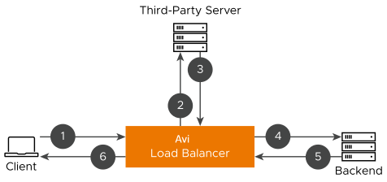

# Out-of-Band Request Processing through DataScripts

This section explains the `avi.requests()` function and the steps to configure out-of-band request processing through DataScripts.

When a virtual service receives a request, either the whole request, parts of the request or an entirely different request can be sent to a third-party endpoint to validate specific criteria. The action on the original request is based on the response thus received. The processing of certain incoming client requests can be paused to retrieve information from an external resource through DataScripts.

An external resource can be either a single server (that may belong to a third-party entity) or a pool of servers. The servers are accessed either by an IP address or an FQDN.

This section explains the DataScript `avi.requests.xxx` DataScript funtion, which enables the following:

* Pause the incoming client requests.
* Configure and dispatch a new HTTP request to an external third-party pool.
* Wait for a response from that third-party pool
* Resume the initial client request, close the connection, or issue a local redirect or custom response.

**Note:**  
<mark>Ensure that the third party or the external entity is configured as a pool in Avi Load Balancer.</mark>

Some use cases for external request validation are:

* Querying an LDAP server to fetch attributes and insert them as headers to a backend server
* Converting token names into user names from a third-party server before sending the information to the server
* Performing Real-time database look up to dynamically block users from specific countries, instead of using a static outdated geolocation IP records.

## Function Overview

**Function:** 
`avi.requests.[get/post/put/head] (pool [, server [, port]], URI [, req_args])`

**Description:** 
Send an external HTTP request to an external, third-party server within the DataScript, whenever an incoming client request comes to Avi Load Balancer. Allows to pause a client request and configuring a custom HTTP request (or forward the original client request), send it to a third-party resource, wait for its response, and then use that response to make load-balancing decisions for the initial client request when sending it to the backend server.

**Functions:**
The HTTP method will be the function name instead of a parameter as follows:

* `avi.requests.get(pool [, server [, port]], URI [, req_args])`
* `avi.requests.post(pool [, server [,port]], URI [, req_args])`
* `avi.requests.head(pool [, server [,port]], URI [, req_args])`
* `avi.requests.put(pool [, server [,port]], URI [, req_args])`
* `avi.requests.patch(pool [, server [,port]], URI [, req_args])`

**Events:**

* HTTP_AUTH
* HTTP_POST_AUTH
* HTTP_REQ
* HTTP_REQ_BODY

## Parameters

* **pool:** `<string>` Name of external pool to select
* **server:** `<string>` [optional] Name of external server
* **port:** `<number>` [optional] Port of external server
* **URI:** `<string>` URI of the external request (path + query string)
* **req_args:** `<table>` [optional] Additional request configurations
  * **headers:** `<table>` Request headers. Values must be a number or a string. Avi Load Balancer will automatically insert headers that are required for HTTP such as:
    * `Host`
    * `Content-Length` (if the request is PUT/POST/PATCH)
    * `Accept: */*`.
  * **body:** `<string>` Request body if the request is PUT/POST/PATCH request. If the request is POST but the request body is not provided or nil, the client's request body is streamed if the event is REQ_BODY. Otherwise, a 500 error is sent.
  * **chunk_buf_sz_kb:** `<number>` Size of the buffer to store chunked body response in KB. The default size is 4 KB. The allowed range is 4 KB to 32768 KB (32 MB).

## Return Value

The table contains the following values:

* **status:** `<number>` Response status code
* **headers:** `<table>` Table of response headers
* **body:** `<string>` HTTP Response body if present

## Configuration

To use the external request validation API, configure a new Pool object with the external server(s) where you want to send the external request to:

```text
[admin:controller]: > configure vsdatascriptset vsds-external-request
[admin:controller]: vsdatascriptset> pool_refs pool-1
[admin:controller]: vsdatascriptset> save
```

**Note:**  
`To send HTTPS requests, configure the pool with an SSL profile and ensure that the server port has an SSL port.`

## Examples

```lua
headers = {
    Host = "www.example.com:80",
    Accept = "*/*",
    ["Content-Type"] = "text/html",
}

req_args = {headers = headers, body = "example body"}
-- Pool must have "Lookup server by name" turned on
resp = avi.requests.post("pool-1", "www.example.com", "/", req_args)
```

Owing to the optional arguments, there are multiple ways to call the `avi.requests.xxxx` API:

```lua
avi.requests.get('pool-1', '/index.html')
avi.requests.get('pool-1', 'www.example.com', '/index.html')
avi.requests.get('pool-1', 'www.example.com', 80, '/index.html')
avi.requests.get('pool-1', '/index_html', req_args)
avi.requests.get('pool-1', 'www.example.com', '/index_html', req_args)
avi.requests.get('pool-1', 'www.example.com', 80, '/index.html', req_args)
```

## Steps to Configure Out-of-Band Request Processing

1. Configure the Pool. The external application can be defined/referred to in multiple ways. It could be a single server or a pool of servers. To use the external pool in the DataScript, attach the pool to the VSDataScriptSet object.
2. Write a DataScript using the `avi.requests()` function.
3. Associate the pool with the DataScript.
4. Bind the DataScript to the virtual service for which out-of-band processing is required.

## Packet Flow in an Out-of-Band Request Processing Scenario

Let us consider the packet flow for a client request resume scenario.



1. The client sends an incoming request which triggers the DataScript condition to send an out-of-band request.
2. The DataScript creates an HTTP request and sends it to the configured external server.
3. The server provides an HTTP response, which will be evaluated by the DataScript.
4. After processing the initial client request based on the external server response, the client request is forwarded to the backend.
5. Avi Load Balancer receives the response from the backend servers.
6. Avi Load Balancer forwards the backend server response to the client.

## Caveats

* Sending multiple out-of-band requests simultaneously is not supported.
* Asynchronous out-of-band requests are not supported.
* Sending chunked requests is not supported.
