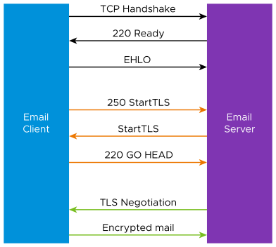
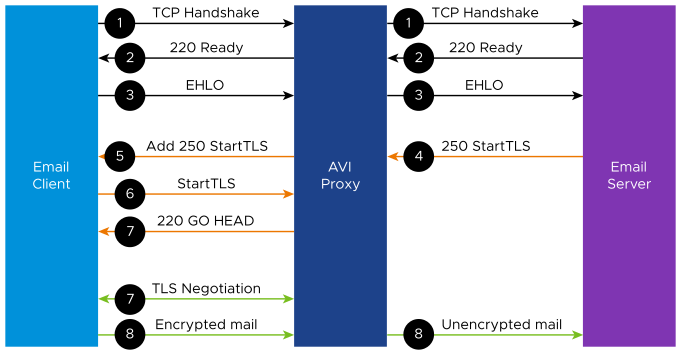

# STARTTLS in Layer 4SSL Virtual Service

The SMTP (Simple Mail Transfer Protocol) is a communication protocol for electronic mail transmission. Based on SMTP, STARTTLS upgrades a plain text connection to an encrypted (TLS or SSL) connection instead of using a separate port for encrypted communication.

## STARTTLS Process Flow

The following is the STARTTLS process flow:

1.  STARTTLS process starts after the TCP handshake.
2.  The server identifies with 220 Ready that the email client can proceed with the communication.
3.  The client sends the server EHLO to inform the server that the client will use Extended SMTP.
4.  The server sends 250 STARTTLS to the client to check if STARTTLS is accepted or not.
5.  The client sends STARTTLS to the server, saying STARTTLS is ok.
6.  The server sends 220 GO Heads to the client if SSL/TLS can be started.
7.  The client starts SSL/TLS with server.
8.  After SSL/TLS is done, email messages are encrypted.

## DataScript Event in Layer 4 SSL

**New DataScript Event:**
*   **Event name:** `VS_DATASCRIPT_EVT_TCP_CLIENT_ACCEPT`
*   **Functionality:** Happens after a TCP handshake is done

**New DataScript API:**

| API Name | Events | Description | Functionality |
| :--- | :--- | :--- | :--- |
| `avi.ssl.disable_ssl()` | `VS_DATASCRIPT_EVT_TCP_CLIENT_ACCEPT` | No argument | Deactivate SSL after a TCP handshake. |
| `avi.ssl.enable_ssl()` | `VS_DATASCRIPT_EVT_L4_REQUEST` | No argument | Activate SSL during the traffic. |

## Traffic Flow

The following is the traffic flow process:

1.  Avi Load Balancer will create a connection to the backend server after TCP handshakes with the client.
2.  Avi Load Balancer sends proxy messages between the client and the server.
3.  The client can send EHLO anytime to the server about the usage of extended SMTP (right after the TCP handshake or after some data is sent).
4.  After receiving EHLO, the server will advertise its services.
5.  If there is no STARTTLS, the system will add 250 STARTTLS as one of the services.
6.  The client can send a request for TLS to STARTTLS.
7.  Avi Load Balancer replies to the client with 220 and then starts TLS negotiation.
8.  After SSL/TLS negotiation, the client sends encrypted mail to Avi Load Balancer.
